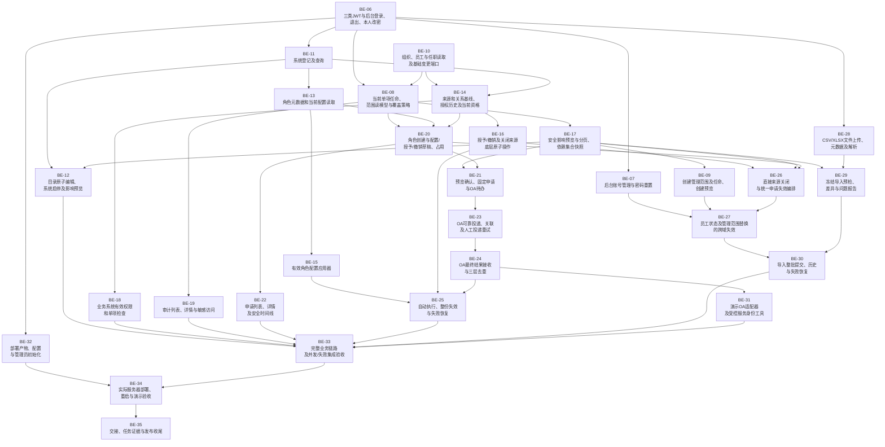

# rbac-admin · 集中权限管理系统

D-083：BE-09已通过[PR #3](https://github.com/Noah-hope/RBAC-admin/pull/3)交付main/5f42a2c，本地及远程已核对，任务分支保留；112普通＋227真实MySQL/HTTP通过。A确认沿用D-082，未进行人工演示；组员可更新main接入，见[交付记录](docs/05-detailed-design/BE-09-SCOPE-CREATION.md)。下方待交付为历史。

D-083：A已授权BE-09通过PR交付main，已接入最新BE-16，正在完整集成验证。实际PR及合并结果成功后补录；下方待授权/未整合是历史，见[BE-09交接](docs/05-detailed-design/BE-09-SCOPE-CREATION.md)。

D-082：A已确认BE-09按自动化测试通过验收，OWNER_ACCEPTED、待主线交付，本机演示未进行。下一步可办理BE-09交付；A剩余BE-27等D/BE-26、BE-34等B/BE-33。下方待A确认是此前历史，见[验收依据及后续演示步骤](docs/05-detailed-design/BE-09-SCOPE-CREATION.md)。

D-081：A/BE-09 的创建预览与范围/任命原子创建已在 `codex/be-09-scope-creation` 实现，待A本人确认，尚未交付main。实现、验证及逐步Apifox操作见[BE-09验收说明](docs/05-detailed-design/BE-09-SCOPE-CREATION.md)；BE-05/08/17技术依赖已在main，下方仍需等待的描述为历史。

D-074（2026-10-20）：BE-17/12 已检查并交付远程 main/3103b35，来源 1fb95ad、任务分支保留。完整 93 普通＋169 真实 MySQL/HTTP 通过，合并后 93 普通回归及静态校验再次通过；组员更新 main 即可复用。本人验收仍开放，BE-18/33/35 未完成；下方待交付为历史，见 [交付与接入](docs/05-detailed-design/BE-17-12-PREVIEW-CATALOG.md)。

D-073（2026-10-20）：B/BE-17 安全影响预览及 BE-12 系统/目录编辑已在任务分支实现，完整 93 普通＋169 真实 MySQL/HTTP 检查通过。两项待本人确认与主线交付，尚未推送/合并 main；BE-18/33/35 仍开放。见 [实现与接入](docs/05-detailed-design/BE-17-12-PREVIEW-CATALOG.md)，下方未实现说明为历史。

D-072（2026-10-20）：B 的 BE-11/13/15 已合入并交付远程 main/0e391c6，来源 b92cdbb；完整 85 普通＋150 真实 MySQL/接口检查及静态校验通过，原设计管理上下文校验已统一。B 分支保留，待负责人验收；其余 B 任务与 OA/发布未完成。详见 [集成交付](docs/05-detailed-design/B-MAIN-INTEGRATION.md)，下方待推送及旧依赖说明为历史。

D-070（2026-10-19）：B 的 BE-11、BE-13、BE-15 已在独立任务分支实现，真实测试和接入约定见 [B 实施记录](docs/05-detailed-design/BE-11-13-15-B-MODULE.md)。待负责人确认，未合并或推送；BE-17/12/18 仍按原依赖等待，完整后端与发布验收尚未完成。下方旧日期的任务数量与运行结果为历史。
D-069：BE-08已按A确认并通过[PR #2](https://github.com/Noah-hope/RBAC-admin/pull/2)交付main/ca85189。本地及远程主线已核对，组员可pull并按[BE-08交接](docs/05-detailed-design/BE-08-MANAGEMENT-SCOPE.md)复用；B可推进BE-17，A/BE-09仍等BE-17。下方待交付为历史。

D-068：A已确认BE-08验证通过，当前待共同main交付。已准备[PR正文](docs/05-detailed-design/BE-08-PR.md)，尚未推送、创建或合并；A后续BE-09仍等B/BE-17。下方待A确认是此前历史。

D-067：A 已在 `codex/be-08-management-scope` 实现任命/范围四查询和单项上下文/覆盖策略，使用 Spring Data JPA 只读仓储，接入 D 已交付的 BE-10。当前待 A 确认、未交付 main；验证结果、Apifox 步骤及 B/C/D 内部接口约定见 [BE-08](docs/05-detailed-design/BE-08-MANAGEMENT-SCOPE.md)。下方较早的任务数量与状态为历史，以共享记忆和任务清单为准。

D-061：A 已实现 BE-32 部署产物、配置与管理员初始化，80 离线＋88 真实 MySQL 检查通过；任务已获本人确认（D-062），并已通过[PR #1](https://github.com/Noah-hope/RBAC-admin/pull/1)合入远程main/609ee4b（D-063）。[IDEA 初始化与发布步骤](deploy/README.md)使用同一份 Java 代码/jar，无需组员现在选择服务器模板或新增一套密钥；实际服务器部署仍由 BE-34 验证。测试与交接见 [BE-32 记录](docs/05-detailed-design/BE-32-DEPLOYMENT.md)，其余27项保持 PLANNED。下方 D-060 及更早的数量/状态为历史。

身份模块与后续目录样例：见[BE-06实现](docs/05-detailed-design/BE-06-IDENTITY.md)和[本机启用及组员接入](docs/05-detailed-design/BE-06-LOCAL-SETUP.md)。

D-060：BE-06身份认证与[BE-07后台账号管理](docs/05-detailed-design/BE-07-ACCOUNTS.md)均已本人确认，已合入并推送main/ff19d17、远程回查一致。当前75离线＋80真实MySQL检查通过；其余28项待实现，下方待主线/旧29项为此前记录。成员可pull共同main后按身份启用说明配置，密钥不随代码提交。

公共基座已完成本人整体确认：BE-01～05为OWNER_ACCEPTED，F-01～06通过，FOUNDATION_ACCEPTED；2026-10-18已合并并推送main/b68aa9a，远程回查一致。BE-06最终74离线＋59真实MySQL检查通过（含基座原64＋42回归），开发/测试库迁移和普通启动已确认；30项业务已按D-055登记A～D分工；D-056用户认领A，BE-06在开发分支实现并获本人确认（D-057），待合入，其余29项待实现。见[整体核对报告](docs/05-detailed-design/FOUNDATION-REVIEW.md)和[后续开发简明指南](docs/05-detailed-design/FOUNDATION-USAGE.md)。

当前业务范围：**仅管理功能权限**。员工经角色获得系统进入及查看、编辑、新增等操作权限；不设计业务数据权限。需求于 2026-10-15 按用户要求修订，说明见[变更记录](docs/project/FUNCTION_PERMISSIONS.md)。

权限管理员按公司、指定部门及系统范围管理；员工离岗关权直接生效。规则见[管理范围与人员权限](docs/01-requirements/usecases-v1/管理范围与人员权限规则.md)。PNG/SVG 按需生成，现有 V1.1 预览已标记，详见[预览维护规则](docs/project/PREVIEWS.md)。

## 四人分工

C / BE-20 已在本地任务分支实现，完整137离线＋265真实MySQL/HTTP检查通过，待负责人确认及主线交付；接口、TDD和验收步骤见[BE-20交接](docs/05-detailed-design/BE-20-CHANGE-DRAFTS.md)。

| 成员 | 负责领域 | 全部任务 |
| --- | --- | --- |
| A | 身份与管理范围、运行交付 | BE-06、07、08、09、27、32、34 |
| B | 系统、角色与功能权限、集成验收 | BE-11、12、13、15、17、18、33、35 |
| C | 申请、OA审批与执行、审计 | BE-19、20、21、22、23、24、25、31 |
| D | 组织、人员与授权来源、导入 | BE-10、14、16、26、28、29、30 |

具体交付、各人推进顺序与接口交接见[四人分工说明](docs/05-detailed-design/TEAM-ASSIGNMENT.md)。A～D为成员代号，用户已认领A（D-056），其他成员姓名/GitHub账号待补；各任务由负责人自行确认完成，不另设评审人。

## 业务开发顺序

基座BE-01～05已通过，图中只展示后续任务。箭头从前置任务指向后续任务；多个箭头汇入同一节点时，须等待全部前置完成。没有前后依赖路径的分支可以并行，BE-06/07已按D-060交付main，D的BE-10、B的BE-11等可按依赖推进；后续任务仍须满足依赖及成员本机接入。

为便于阅读，省略了已经由路径表达的重复前置依赖；完整依赖以[任务清单](docs/05-detailed-design/TASKS.md)和[任务数据](docs/05-detailed-design/issues.json)为准。



## 已确认技术栈

2026-10-16 用户确认，决策见 [D-028](docs/project/DECISIONS.md)：

| 领域 | 已确认选型 |
| --- | --- |
| 前端 | Vue 3 + TypeScript + Tailwind CSS |
| 后端 | Spring Boot + Spring Data JPA |
| 数据库 | MySQL |
| API 风格 | RESTful API；使用 Apifox 管理契约 |
| 身份认证凭证 | JWT；功能授权仍按 RBAC 规则判断 |
| 分析与设计方法 | 结构化分析与结构化设计 |

选型已确认，[API 契约 1.2.0](docs/03-api/README.md) 已完成正式跨阶段评审修订及静态校验，设计层面有条件通过；Apifox1.2.0指定客户端导出核心一致已核对，历史证据及MCP限制保留；JWT 生命周期及失效规则已有接口设计。[数据库设计草案](docs/04-database/README.md)已交付，MySQL8.4及后端具体版本已有可评审技术取值；BE-02～05公共机制已实现并单项确认，结构迁移及基础持久化/事务/幂等已验证；正式业务/认证尚未实现，[正式需求—API—数据库一致性评审](docs/04-database/CONSISTENCY-REVIEW.md)已完成修订，数据库草案1.1；[后端详细设计1.3](docs/05-detailed-design/README.md)及35个本地Issue草案已交付，迁移/测试/工程布局已有设计取值；真实引擎已验证公共机制，完整业务及服务器验收留后续。

## 分析与设计方法

本项目采用**结构化分析与结构化设计方法**，以自顶向下、逐步求精的方式分解业务处理和系统模块，并以高内聚、低耦合作为模块划分原则。

- 需求分析阶段：结合用例明确参与者、业务规则和验收行为，通过顶层及第一层数据流图描述系统边界、处理过程、数据流和逻辑存储，保持上下层数据流平衡。现有依据见[数据流图与数据流分析](docs/01-requirements/dataflows-v1/README.md)。
- 设计阶段：在需求、界面、API 和数据库设计的基础上，将处理过程逐步细化为职责明确的模块，说明模块层次、调用关系、输入输出、接口、异常及事务边界，并建立需求到模块和测试的追踪关系。数据流中的处理过程和逻辑存储不直接等同于代码模块和数据库表。
- 表达与验证：用例、活动图和时序图辅助描述业务行为；详细设计通过模块结构与接口说明落实结构化设计，实现通过 TDD 验证业务结果及边界。

上述内容说明项目采用的方法；详细设计已交付，公共基座已有实际TDD、隔离数据库及本机验证，完整业务与部署仍待实现。当前阶段及交付事实以[项目共享记忆](docs/project/MEMORY.md)为准，详细流程见[开发流程](docs/project/WORKFLOW.md)。

## 阅读入口

- [协作规则](AGENTS.md)：每次开展工作先读。
- [项目共享记忆](docs/project/MEMORY.md)：当前阶段、事实、待办和交接入口。
- [开发流程](docs/project/WORKFLOW.md)：五个阶段及 TDD 执行要求。
- [决策记录](docs/project/DECISIONS.md)：用户已确定的约束与后续变更依据。
- [统一术语表](docs/project/GLOSSARY.md)：团队及 agent 交流使用的名称、别称、定义和边界示例。
- [团队文档总入口](docs/README.md)：共享记忆及五个阶段的资料导航。
- [需求资料](docs/01-requirements/README.md)：正式需求分析及配套图。
- [需求总览与统一规则](docs/01-requirements/usecases-v1/用例说明.md)：2026-10-15 功能权限修订，保留 UC-01～UC-11。
- [按用例分类阅读](docs/01-requirements/按用例分类/README.md)：详细说明、简表和图的同步阅读副本。
- [导入说明](docs/project/IMPORT.md)：资料来源、校验方式及导入边界。
- [前端界面原型](docs/02-ui-design/README.md)：页面、启动方式和原型验证。
- [Material 3 界面方案](docs/02-ui-design/MATERIAL3-PLAN.md)：已确认并实施的页面、导航、Token 与改造清单。
- [阶段评审](docs/02-ui-design/STAGE-REVIEW.md)：原型有条件通过，可作为 API 设计输入；3 项原型缺口及契约同步待办。
- [数据库设计](docs/04-database/README.md)：实体关系、数据字典、并发/幂等/JPA、DDL草案、静态自查及交接。
- [后端详细设计与实施任务](docs/05-detailed-design/README.md)：1.3实施计划；负责人自行确认，13模块、5项用户先行基座、30项验收后待分派任务及局部验证边界。
- [项目技能](docs/project/SKILLS.md)：仓库内四个技能的入口、来源、版本和文件摘要。

## 当前目录

```text
rbac-admin/
├── AGENTS.md
├── README.md
├── .agents/skills/
│   ├── grill-me/
│   ├── grilling/
│   ├── frontend-design/
│   └── test-driven-development/
├── backend/                 # 正式后端Maven工程
└── docs/
    ├── README.md
    ├── project/
    ├── 01-requirements/
    ├── 02-ui-design/
    ├── 03-api/
    ├── 04-database/
    └── 05-detailed-design/
```

界面阶段已有可运行交互原型，位于 `docs/02-ui-design/prototype/`，可作为 API 设计输入。API 本地设计与[评审修订](docs/03-api/REVIEW.md)已交付于 `docs/03-api/`，已导入Apifox并核对指定客户端导出，MCP暴露差异见同步记录；数据库设计已交付于`docs/04-database/`，初始迁移及基础持久化/事务/幂等已有真实隔离MySQL验证；BE-01～05公共基座已实现、本人确认并交付main，BE-06～35业务/交付任务仍待分派和实现；按 D-029，3 项原型展示/演示补齐后续跟踪，不作为 API 启动或契约定稿前置，对应业务规则保留。目录约定及迁移说明见 [LAYOUT.md](docs/project/LAYOUT.md)。

## 规定的项目流程

1. 需求分析：使用 `grill-me`（实际调用 `grilling`）。本项目已有需求分析作为起点，新增或变更需求再按该方式澄清。
2. 界面原型设计：使用 `frontend-design`，Vue 3 + TypeScript + Tailwind CSS。
3. API 设计：使用 Apifox，并通过 Apifox MCP 协作，契约同时纳入 Git。
4. 数据库设计：依据已确定的需求与接口契约设计。
5. 详细设计与实现：先生成设计文档、分解业务流程和模块，再使用 TDD skill，逐模块执行“失败测试 → 最小实现 → 重构”。

各阶段的交付内容见[开发流程](docs/project/WORKFLOW.md)。技术栈已按 D-028 确认，具体版本、工程布局与测试框架已有详细设计取值，公共基座组合已验证，完整业务与目标服务器部署继续按对应任务验收。

## Git 共享记忆

阶段状态、待办、设计决策、需求和验证证据统一写入 `docs/`，与对应改动一起提交。其他协作者或新的会话从 `AGENTS.md` 进入并读取 `docs/project/`，不另建根目录状态文件。`.agents/skills/` 仅保存技能，不作为项目事实记忆。

远程仓库：[Noah-hope/RBAC-admin](https://github.com/Noah-hope/RBAC-admin)。设计与公共基座已合并并推送至 `main`；后续任务使用任务分支和Issue/PR记录协作，按D-051由唯一负责人核对证据并确认完成，不设置独立评审人。
