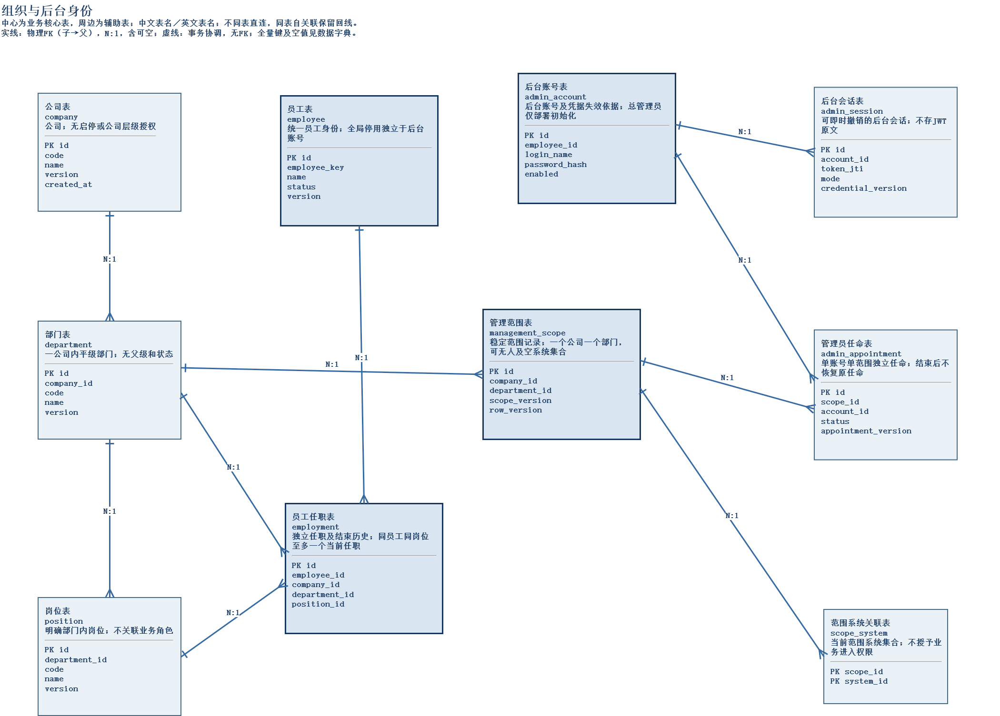
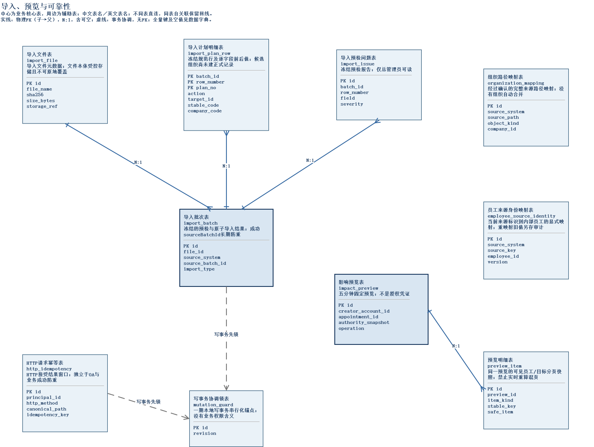
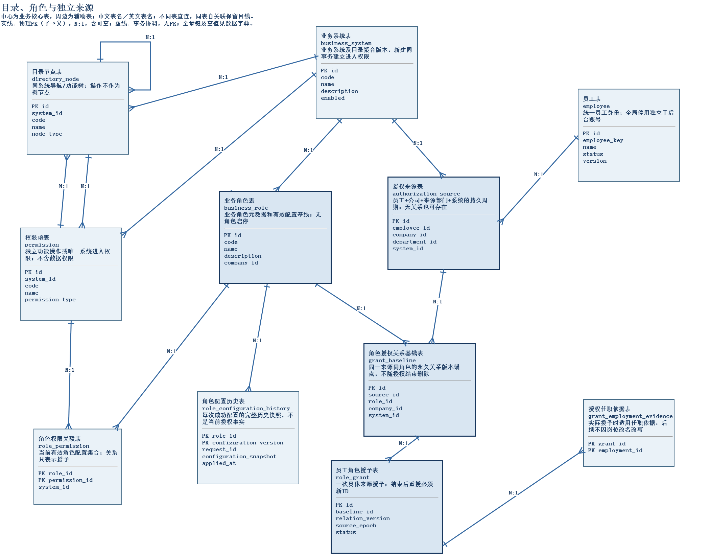
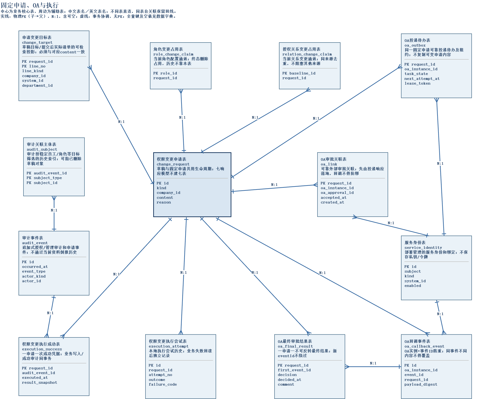

# RBAC权限管理系统

面向多公司、多部门和多个业务系统的集中功能权限管理系统。统一维护员工组织、管理员范围、权限目录和角色授权；权限变更经OA审批后执行，并向业务系统提供有效权限查询、单项权限检查及审计追溯。项目采用结构化分析与设计，使用Vue 3、Spring Boot和MySQL实现。

## 项目资料与访问地址

| 资料 | 地址与说明 |
| --- | --- |
| 项目设计文档（PDF） | [项目设计说明书](output/pdf/集中权限管理系统项目设计说明书.pdf) |
| 数据库设计文档（PDF） | [数据库设计说明书](output/pdf/RBAC权限管理系统数据库设计说明书.pdf) |
| 数据库ER图资源 | [数据库设计资源目录](docs/04-database/) · [四页ER图源文件](docs/04-database/database-erd.drawio) |
| 顶层数据流图 | [顶层资源目录](docs/01-requirements/dataflows/context/) · [系统边界级图源](docs/01-requirements/dataflows/context/系统边界级数据流图.drawio) |
| 第一层数据流图 | [第一层精简总览图源](docs/01-requirements/dataflows/第一层数据流总览.drawio) |
| API文档 | [https://wpqk6zdtzr.apifox.cn](https://wpqk6zdtzr.apifox.cn) |
| JaCoCo测试报告（PDF） | [JaCoCo测试报告](output/pdf/JaCoCo测试报告-2026-10-27.pdf) · [完整HTML报告压缩包](docs/05-detailed-design/reports/JaCoCo-2026-10-27.zip) |
| 项目前端 | [https://121.36.30.6/](https://121.36.30.6/) |

设计文档的AsciiDoc源文件位于[项目文档目录](docs/06-project-document/)。JaCoCo报告对应2026-10-27的700项后端测试：失败、错误、跳过均为0，行覆盖率和方法覆盖率均为100%，分支覆盖率为78.59%。

## 数据库ER图

### 组织与后台身份



### 导入、预览与可靠性



### 目录、角色与独立来源



### 固定申请、OA与执行



## API测试说明

1. 打开上方API文档，访问密码为 **`rbacadgn`**。
2. 选择“管理员登录”接口：**`POST /api/v1/admin/sessions`**。登录接口无需携带令牌，鉴权选择“无需鉴权”。
3. 使用文档配置的运行环境发送以下JSON请求体：

   ```json
   {
     "loginName": "initial.admin",
     "password": "newcode123456"
   }
   ```

4. 登录成功返回 **`201 Created`**，响应中的`accessToken`用于后续管理员接口。在鉴权栏填写该令牌，或设置请求头`Authorization: Bearer <accessToken>`。
5. 调用 **`GET /api/v1/admin/sessions/current`**，返回`200 OK`即可查看当前管理员会话和身份。

API文档访问密码用于打开文档，管理员账号密码用于登录测试系统。上述令牌用于管理员接口；业务系统权限查询、OA结果接口使用各自的服务身份。

## 公共基座与四个主要模块

**公共基座**提供统一配置、持久化支持、读写事务边界、请求幂等、审计追加和错误响应。业务写入与关键审计在同一事务中提交，失败整体回滚；写入前重新检查当前资格，重复请求在重新鉴权后回放原结果。

| 模块 | 主要功能 |
| --- | --- |
| A：后台身份与管理范围 | 管理员登录、退出、改密、账号启停与重置；维护管理范围和独立任命，处理资格变化及旧会话失效。 |
| B：系统、角色与功能权限 | 维护业务系统、目录和独立权限项，管理角色及有效配置；提供影响预览、员工有效权限查询和单项权限检查。 |
| C：申请、OA审批执行与审计 | 编制与提交权限变更申请，对接OA投递和结果接收；批准后整份执行、处理失败恢复，提供申请和审计查询。 |
| D：组织人员、授权来源与导入 | 维护公司、部门、岗位、员工及任职；保存独立授权来源和授予历史，处理离岗关权及CSV/XLSX文件预检、整批导入。 |

四个模块共同使用公共基座。员工状态、范围变化和导入涉及多个领域，由生命周期服务协调相关授权、会话和申请的失效。

## 后端代码包结构

代码位置：[backend/src/main/java/com/adgn/backend](backend/src/main/java/com/adgn/backend/)。

```text
com/adgn/backend/
├── bootstrap/   # 独立管理员初始化入口
├── catalog/     # 业务系统、目录节点与权限项的查询、规划和保存
├── change/      # 角色配置、分配和撤销草稿，目标占用及固定申请提交
├── core/        # 公共配置、持久化、事务、幂等和审计追加能力
├── demo/        # 受控OA演示适配器及服务身份令牌工具
├── execution/   # 已批准申请的整份执行、失败记录与后台恢复
├── grant/       # 授权来源、关系基线、具体授予、撤销和来源关闭
├── identity/    # 后台账号、密码、JWT、会话及当前身份检查
├── imports/     # 导入文件存储与解析、冻结预检计划及整批提交
├── lifecycle/   # 离岗、员工停用和范围替换引起的跨领域失效
├── migration/   # 独立数据库迁移入口
├── oa/          # OA可靠投递、审批关联及最终结果接收
├── people/      # 公司、部门、岗位、员工与任职的基础读取和写入
├── query/       # 安全查询投影、有效权限计算、影响预览和审计查询
├── role/        # 角色元数据、当前配置读取及有效配置应用
├── scope/       # 管理范围、管理员任命、上下文与范围覆盖检查
└── web/         # HTTP控制器、请求响应对象、鉴权适配与统一错误处理
```

`web`接收请求并调用相应业务服务；业务服务通过`core`的事务边界完成校验和保存。`query`按业务场景读取多个领域的数据并生成安全响应，`lifecycle`负责协调多领域失效。`bootstrap`和`migration`是独立运维入口，普通后端启动不会自动执行管理员初始化或数据库迁移。
