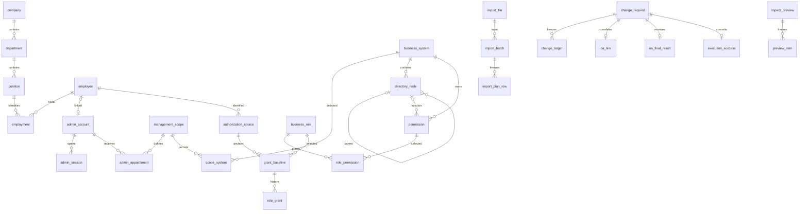

# 逻辑模型与关系

本模型从正式需求和API持久化事实建模，先区分身份、资格、有效授权、固定申请和历史。OpenAPI的Page、七个申请状态分支、权限查询结果、错误和版本头均不是独立业务表。

## 实体与基数

| 逻辑组 | 实体/关系及基数 | 不变量 |
| --- | --- | --- |
| 组织 | 公司1:N平级部门，部门1:N岗位；员工与岗位通过任职N:M | 岗位不授权；同一员工同岗位当前一项，可保留多次结束历史 |
| 来源身份 | 员工1:N当前外部标识映射；显式组织来源完整路径映射 | employeeKey全局唯一，sourceSystem+sourceKey唯一；更名不重建ID，重映射留审计 |
| 后台 | 员工0:1后台账号；部署总管理员账号可不关联员工；账号1:N会话 | 后台账号、员工状态、超级身份/任命、业务授权独立 |
| 任命 | 账号与范围通过任命N:M；范围1:N系统集合 | 一范围一个公司/部门；同范围同账号最多一项ACTIVE；可空系统/无人 |
| 目录 | 系统1:N节点，节点自关联0:1父；FUNCTION1:N操作，系统1:1进入权限 | 父级同系统、无环；启用功能绑定自身合法menuEligible权限；操作独立 |
| 角色配置 | 角色固定公司/可选部门/系统；角色与权限N:M；角色1:N成功配置历史 | 公司级共享角色只允许总管理员维护；未配置0项，生效至少1项 |
| 授权 | 来源=员工/公司/部门/系统；来源与角色通过永久关系基线关联；基线1:N具体grant | 同来源同角色当前至多1个ACTIVE，不同部门并存；结束/重授推进版本 |
| 申请 | 申请1:N实际目标投影；角色配置申请1目标；分配/撤销1～100目标 | 草稿可编辑，提交固定；角色/关系唯一当前占用；终态释放占用 |
| OA | 申请0:1投递待办、可靠关联、最终结果、成功执行凭据；申请1:N回调/尝试/事件 | OA实例+审批ID唯一，实例+eventId唯一，一申请一最终结果、一次成功执行 |
| 导入 | 文件1:N冻结批次；批次1:N规范动作/问题 | 预检不建正式数据；批次按源编号长期防重，全批原子提交 |
| 预览/审计 | 预览1:N安全明细；业务动作1:N审计事件 | 5分钟快照，当前资格复核；历史事件只追加，不恢复当前授权 |

当前可编辑图为[database-erd.drawio](database-erd.drawio)，共四页，展示43张不同表与46条关系；中文及英文表名、核心居中与辅助围绕、45跨表直线及1自关联回线已于2026-10-26完成原生渲染检查。验证使用本地Edge和官方drawio运行时，不代记桌面客户端人工验收。Mermaid为逻辑关系摘要；SYSTEM_ACCESS例外、可空外键及全部辅助关系以数据字典为准。与数据流图D1～D8的逻辑存储区分：同一逻辑存储可以由多张物理表实现，本次未改变关系模型。

## 正规化与历史边界

当前实体、集合与多对多关系按3NF分离：任职、范围系统、角色权限、独立来源及永久关系基线。姓名、公司编码不作为外键。role_grant通过baseline/source取得员工和公司/部门/系统；API Grant是联结投影，不重复存一份可变员工资料。Appointment.employeeId、scopeVersion、公司/部门/系统也由账号/当前范围读取，不把范围版本当任命版本。

为保证同公司/同系统，若干子表带冗余company_id/system_id并用复合外键约束一致；这属于完整性冗余，不是性能测得后反范式。change_target是为查找受影响申请建立的固定内容投影；提交事务从同一规范内容生成并逐项核对，之后触发器禁止修改。original_authority和target_snapshot保存当时依据，不通过当前名称/任职列表重新拼出旧申请。

历史快照JSON用于不可变审批、审计、导入计划和预览，内部均有schemaVersion或契约形状。当前可更新的角色权限、范围系统、有效任职等不装入逗号串或JSON替代关系约束。role_configuration_history保存成功配置的完整历史，不作为权限查询来源；审计快照保存当时名称与差异，避免随后改名改变历史解释。

fixed_payload_bytes保存RFC8785规范字节，content_digest为这些字节SHA-256；MySQL JSON会以内部格式存储，不能直接用其序列化值重算OA摘要。content/目标投影/原依据与规范字节一致性在提交事务确认，固定后不可修改；执行前可再次校验损坏，失败返回DATA_INTEGRITY_ERROR，不默认放行。

## 源标识与导入映射

employee.employee_key是当前平台统一键；employee_source_identity保留当前来源键→稳定employeeId，可有多个经过显式确认的来源映射。不同来源出现已存在employeeKey时阻断自动新建，不能据姓名自动合并；新增第二来源映射需在详细设计中明确现有稳定ID依据，不提供猜测匹配。

重映射通过previousEmployeeKey与源映射确认原人，原子更新统一键/相应源键及版本，旧值留在审计和冻结计划；旧键不继续作为业务查询别名。当前唯一键负责当前冲突，历史不占用当前唯一键；不擅自添加“所有历史用户名永不可再用”的规则。复用旧键、跨源映射的实际资料需显式预检，不自动认领旧授权，内部ID始终不变。

组织无编码时，预检按明确sourcePath分配候选UUID及稳定code，只写import_plan_row。提交检查候选编码仍唯一，再按公司→部门→岗位→员工→任职顺序建立正式记录和organization_mapping；重检冲突整批STALE。后续更名通过ID/code或已有映射，绝不按相似名称重新归并。
